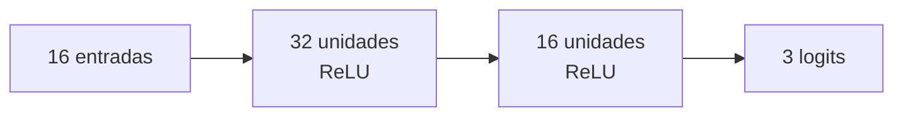
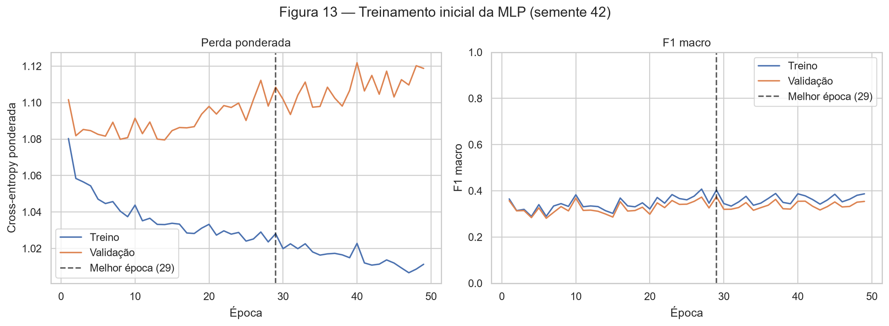
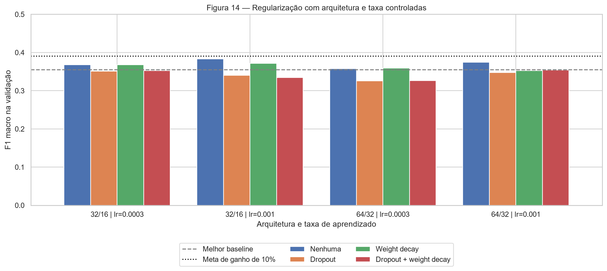
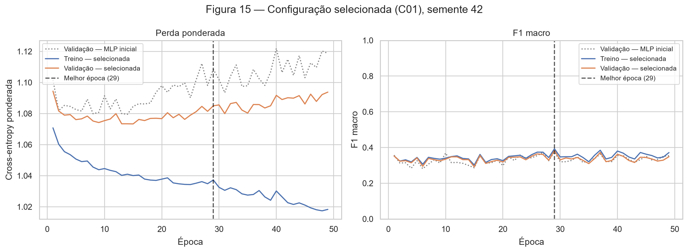
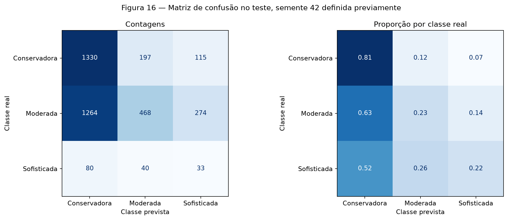
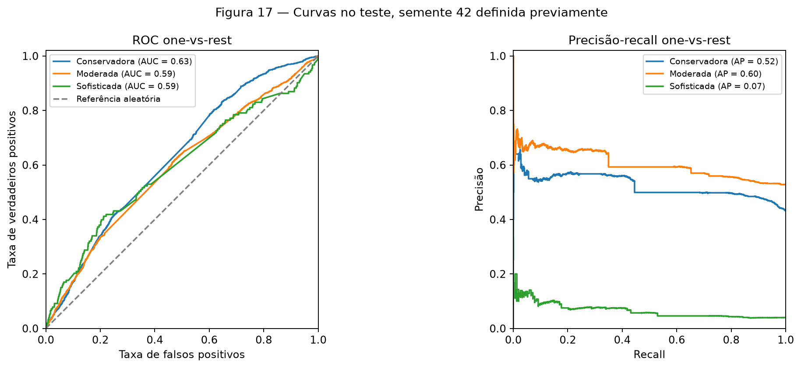
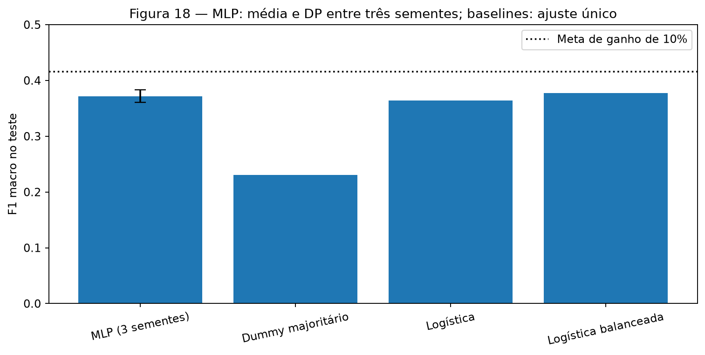

# 2. Classificação do perfil de investimento

Este relatório documenta a classificação multiclasse de `investmentPolicy` a partir da
composição observada da carteira e do tipo de pessoa. A pergunta é se uma MLP melhora a
classificação em relação a modelos mais simples, respeitando o pipeline e o teste do EDA.

O arquivo principal é o [notebook iniciado pela equipe](classification_perfil_investimento.ipynb).
A parte inicial preserva o desenvolvimento do colega e suas saídas. A seção
**Resultados dos experimentos adicionais** resume as tabelas e figuras já registradas.
O [notebook de experimentos](experimentos_classificacao.ipynb) reúne a implementação,
a busca e as verificações adicionais em células Python comuns.
A [conclusão já escrita pela equipe](conclusao_classificacao.md) foi incorporada ao notebook.
O [EDA](../eda/EDA_perfil_investimento.ipynb) permanece como referência dos dados.
A organização abaixo segue as etapas da [rubrica de classificação ou regressão, edição 2026.2](https://insper.github.io/ann-dl/pt/2026.2/projects/supervised/).

!!! info "Estado da entrega"

    O desenvolvimento original já inclui baselines, MLP, oito configurações, teste com três
    sementes e erros por subgrupo. Os complementos acrescentam comparação controlada de 16
    configurações, regras de decisão, protocolo final e curvas. Ambos mantêm seus resultados
    registrados; nenhum atingiu o critério de sucesso adotado na sua versão. Ainda faltam
    piores exemplos com hipóteses, importância por permutação e a síntese conjunta final.

### Integração dos dois desenvolvimentos

| Item | Protocolo A — desenvolvimento original | Protocolo B — complemento |
|---|---|---|
| Critério registrado | Ganho de 15% sobre o baseline | Ganho de 10%, mantido como histórico do complemento |
| Treino / validação / teste | 12.162 / 3.041 / 3.801 | 11.402 / 3.801 / 3.801 |
| Treino | AdamW, batch de referência 128, early stopping por perda | Adam, batch 64, early stopping por F1 macro |
| Busca | 8 configurações | 16 configurações em comparação controlada |
| Rede escolhida | 16 → 128 → 64 → 3; 10.627 parâmetros | 16 → 32 → 16 → 3; 1.123 parâmetros |
| F1 macro no teste, média ± desvio | Aproximadamente 0,316 ± 0,021 | 0,3719 ± 0,0114 |
| Baseline de referência no teste | Logística balanceada: aproximadamente 0,308 | Logística balanceada com regra validada: 0,3777 |

O critério original de **15% foi preservado** no notebook do colega. O critério de 10% e
os resultados detalhados nas etapas 0–5 abaixo pertencem ao **protocolo complementar B**,
que já havia sido executado antes da integração. A diferença entre os resultados A e B
não é uma comparação controlada entre arquiteturas: mudam também split de validação,
otimizador, seleção de época e regra de decisão. A integração apenas reúne código e
evidências existentes; não executou novamente os testes nem os trata como uma nova
avaliação independente em holdout.

O resumo adicional no notebook principal apenas lê resultados salvos. Para reproduzir
o protocolo B, execute o notebook de experimentos em uma sessão própria. Cada notebook
usa células Python comuns, sem comandos personalizados ou execução de outro notebook.

### Equipe

| Nome |
|---|
| Karyne Alencar |
| Matheus Braido |
| Renan Mello |

## 0. Ponto de partida

### Dataset, tarefa e alvo

A unidade observacional é **uma conta de cliente**. O conjunto analítico reúne
**19.004 contas**, com **15 features utilizadas antes do encoding** (14 numéricas e uma
categórica) e **16 entradas depois do pré-processamento**. O alvo é `investmentPolicy`,
com três classes exclusivas:

| Classe | Contas | Proporção |
|---|---:|---:|
| Conservadora | 8.208 | 43,19% |
| Moderada | 10.031 | 52,78% |
| Sofisticada | 765 | 4,03% |

As fontes locais são `clientes_wallet_distribution.json` (composição da carteira),
`clientes_investment_policy.json` (alvo) e `account.json` (`personType`). As entradas incluem
percentuais por grupo de ativos, quantidade de grupos ativos, maior participação na
carteira e tipo de pessoa. `accountCode` é usado no cruzamento das fontes e fica fora das
entradas, assim como suitability e campos derivados da policy. `pct_future`, identificado
como constante no EDA, foi excluído da lista de features.

!!! note "Informação de origem a confirmar"

    Falta a equipe registrar a origem institucional ou URL de obtenção dos três JSONs e seus
    termos de uso. Esses campos não foram inferidos a partir dos nomes dos arquivos.

### Pipeline herdado e prevenção de vazamento

O pré-processador reutiliza `build_preprocessor`, definida dentro do próprio
[notebook de experimentos](experimentos_classificacao.ipynb):

| Tipo | Transformações | Motivo |
|---|---|---|
| Numéricas | Mediana e StandardScaler | Tratar faltantes e colocar as entradas em escala comparável |
| `personType` | Moda e one-hot, ignorando categorias desconhecidas | Tratar faltantes e representar uma categoria nominal |
| Valores extremos válidos | Mantidos | Carteiras concentradas em 90% ou 100% de um grupo podem ser reais |

No desenvolvimento, todas as estatísticas do pipeline são ajustadas somente no treino
interno. A validação recebe apenas `transform`. O pré-processador ajustado no EDA é guardado
separadamente; ele não é usado para selecionar a MLP na validação. No retreino final, um novo
pré-processador é ajustado no treino externo completo. PCA, t-SNE e UMAP continuam como
análises do EDA, sem substituir as entradas dos classificadores.

### Divisão dos dados

O teste externo de 20% é o mesmo do EDA, com estratificação e semente **42**. A validação
sai de 25% do treino externo, também estratificada e com semente 42.

| Uso durante o desenvolvimento | Linhas | Parcela aproximada do total |
|---|---:|---:|
| Treino interno | 11.402 | 60% |
| Validação | 3.801 | 20% |
| Teste externo | 3.801 | 20% |

Após as decisões na validação, treino interno e validação foram reunidos em **15.203 linhas**
para o retreino final. O conjunto de teste não orientou configuração, épocas, regra de
classificação ou escolha de semente.

### Métrica principal e critério numérico

A métrica principal é **F1 macro**, média simples do F1 das três classes. Isso evita que o
resultado seja dominado pela frequência de Moderada e Conservadora. A equipe confirmou
**F1 macro sem custo adicional por tipo de erro**. Os pesos de classe na perda compensam
frequências no treino; não representam uma matriz de custos financeiros.

No protocolo complementar B, o critério registrado antes de seus treinos é um **ganho
relativo de pelo menos 10% sobre o melhor baseline**, comparando os modelos na mesma partição. A validação orienta as escolhas;
na confirmação final, comparamos a **média do F1 macro das três sementes da MLP** com o F1
macro no teste do baseline escolhido na validação:

`F1_macro_MLP_médio_teste >= 1,10 × F1_macro_baseline_teste`

As referências numéricas antes e depois de finalizar a regra de decisão do protocolo B
são distinguidas na etapa 5. Sua exigência de 10% é mantida como registro desse protocolo;
o critério de 15% do desenvolvimento original A não foi substituído.

### Reprodução

Os três JSONs devem estar em `Dados/`, na raiz do repositório. Instale as dependências de
`requirements.txt` e execute o notebook de experimentos em ordem, usando o ambiente do
projeto. Os caminhos são localizados a partir da raiz do repositório. Os dados brutos e checkpoints são locais; código, tabelas de resultados e figuras
compõem o registro da entrega. O protocolo e as previsões finais salvas permitem refazer
tabelas e figuras sem consultar os modelos no teste novamente.

!!! note "Organização do código escolhida para este projeto"

    Por preferência da equipe, todo o código está nos notebooks, incluindo as verificações.
    A rubrica solicita arquivos em `code/` para a rede e o loop de treino. A organização
    exclusivamente em notebooks difere desse requisito de formato.

## 1. Baselines

Foram ajustados no treino interno e avaliados na mesma validação, com cópias novas do
pipeline do EDA:

- **DummyClassifier**, estratégia `most_frequent`: sempre prevê a classe majoritária.
- **Regressão logística**, `C=1`, `lbfgs`, limite de 3.000 iterações, sem pesos de classe.
- **Regressão logística balanceada**, com os mesmos parâmetros e `class_weight="balanced"`.

A regressão logística verifica se fronteiras lineares nas features já explicam o alvo.
A versão balanceada aumenta o peso das classes raras na perda. Os resultados abaixo são
os da primeira comparação, **antes do ajuste de regra, com argmax**:

| Baseline | F1 macro treino | F1 macro validação | Acurácia validação | Recall Sofisticada |
|---|---:|---:|---:|---:|
| Logística | 0,3509 | 0,3550 | 55,77% | 0,00% |
| Logística balanceada | 0,3195 | 0,3102 | 40,70% | 32,68% |
| Dummy majoritário | 0,2303 | 0,2303 | 52,78% | 0,00% |

A logística sem pesos foi a melhor referência nessa fase, mas não acertou exemplos de
Sofisticada. A logística balanceada recuperou 32,68% dessa classe, com redução do F1 macro
global. A acurácia de 52,78% do Dummy mostra por que acurácia isolada não basta neste conjunto.
Na etapa 5, o mesmo procedimento de ajuste de regra é aplicado à rede e aos baselines,
antes de congelar a comparação final.

## 2. A rede

### Arquiteturas de referência e selecionada

A hipótese é que combinações não lineares de composição, concentração e tipo de pessoa
ajudem a distinguir os perfis além das fronteiras lineares da logística. A arquitetura
inicial usa 64 e 32 unidades ocultas. A busca posterior selecionou uma rede menor:

| Configuração | Arquitetura | Parâmetros treináveis | Linhas de treino interno |
|---|---|---:|---:|
| Referência inicial | 16 → 64 → 32 → 3 | 3.267 | 11.402 |
| Selecionada, C01 | 16 → 32 → 16 → 3 | 1.123 | 11.402 |

A razão entre parâmetros e linhas passa de **0,287** na referência para **0,098** na
selecionada. Essa comparação descreve a capacidade; não garante ausência de overfitting.
A seleção da largura menor se apoia no resultado da validação da etapa 4.

| Escolha | Justificativa |
|---|---|
| ReLU nas camadas ocultas | Introduz não linearidade com otimização simples |
| Inicialização He nas camadas ocultas | Controla a escala inicial dos pesos para ReLU |
| Xavier na saída; biases zerados | Inicialização explícita da projeção linear final |
| Três logits, sem softmax no `forward` | Uma saída por classe exclusiva; formato esperado por CrossEntropyLoss |
| CrossEntropyLoss com pesos de classe | Trata a tarefa multiclasse e o desbalanceamento usando somente frequências do treino |
| Entradas float32 e alvos inteiros | Representação usada pelo loop de treino em PyTorch |

Na ordem Conservadora, Moderada, Sofisticada, os pesos da perda no retreino final são
aproximadamente **(0,7718; 0,6315; 8,2805)**. Softmax é usado para obter as probabilidades
na avaliação, não antes da perda. O ajuste final dessas probabilidades para decidir a
classe é documentado na etapa 5.

A implementação do protocolo B está no [notebook de experimentos](experimentos_classificacao.ipynb),
em células de pré-processamento, rede, treino, retreino final, regras de decisão, métricas e
verificações. O notebook principal preserva o protocolo A e resume os resultados adicionais.
Foram verificadas a arquitetura, a restauração dos melhores
pesos, a reprodução com a mesma semente, o comportamento de dropout, a perda ponderada,
o retreino fixo, o alinhamento das probabilidades e a seleção da regra.

## 3. Treinamento

### Configuração definida para o desenvolvimento

| Item | Valor | Justificativa |
|---|---|---|
| Otimizador | Adam | Adapta as atualizações por parâmetro |
| Taxa inicial | 0,001 | Referência fixada antes do primeiro treino e depois comparada a 0,0003 |
| Batch size | 64 | Custo baixo em CPU e várias atualizações por época |
| Limite | 200 épocas | Limita a execução, com parada antes do limite se a validação não melhorar |
| Early stopping | 20 épocas sem novo máximo de F1 macro na validação | Acompanha a métrica principal e tolera oscilações |
| Pesos restaurados | Maior F1 macro; primeira ocorrência em empate | Impede usar os pesos da última época por conveniência |
| Reprodutibilidade | Semente 42, CPU e uma thread | Controla inicialização e embaralhamento neste ambiente |

O loop usa `model.train()`, zera gradientes, calcula a perda, executa `backward()` e atualiza
os pesos. A avaliação usa `model.eval()` e `torch.inference_mode()`. Uma cópia independente
dos melhores pesos é mantida e restaurada ao terminar. O exemplo do enunciado acompanha a
menor perda de validação; aqui a seleção usa o maior F1 macro, como definido antes do treino.

As perdas por época são calculadas sobre os conjuntos completos, em modo de avaliação e
com os mesmos pesos de classe. A referência usa dropout e weight decay iguais a zero.
O melhor resultado inicial ocorreu na **época 29**, e o treino parou na **49**, após 20 épocas
sem um novo máximo. O ajuste durou aproximadamente **25,5 segundos**, sem contar a leitura.
O checkpoint restaurado teve F1 macro de validação **0,3747**, contra **0,3550** da logística:
ganho de **5,53%**, insuficiente para a meta inicial de **0,3905**.

### Rede de referência inicial

/// caption
**Figura 13** — Perda ponderada e F1 macro por época no primeiro treinamento, com semente 42.
A linha vertical marca a melhor época pelo F1 macro de validação.
///

A perda de treino caiu de **1,0803** para **1,0113**. A perda de validação atingiu o mínimo
na época 14 (**1,0795**) e terminou em **1,1187**, indicando divergência entre os conjuntos,
aproximadamente a partir da época 15. Esse comportamento sugere overfitting. A oscilação do
F1 macro também mostra ausência de uma melhora sustentada na validação.

A menor perda de validação não determina o checkpoint neste experimento: a seleção foi
fixada pelo F1 macro, que alcançou o máximo na época 29. O histórico completo está em
`results/mlp_initial_seed42_history.csv`; configurações e métricas estão em
`results/mlp_initial_seed42_summary.json`.

## 4. Regularização e hiperparâmetros

A busca foi definida como **2 arquiteturas (32/16 e 64/32) × 2 taxas (0,001 e 0,0003) ×
4 opções de regularização**, totalizando **16 configurações**. Comparamos nenhuma técnica,
**dropout de 0,2**, **weight decay de 0,001 no Adam** e a combinação das duas. Foram mantidos
o split, o pré-processamento, os pesos de classe, batch 64, limite de 200 épocas, paciência
20 e semente 42. Os pesos de classe tratam desbalanceamento, sem contar como regularização.

A escolha usa maior F1 macro na validação; em empate, menos parâmetros e depois menor ID.
A tabela está ordenada por esse critério, usando os melhores pesos de cada execução.

| ID | Camadas ocultas | Taxa | Regularização | F1 macro validação | Melhor época |
|---|---|---:|---|---:|---:|
| C01 | 32/16 | 0,001 | Nenhuma | 0,3829 | 29 |
| C09 | 64/32 | 0,001 | Nenhuma | 0,3747 | 29 |
| C03 | 32/16 | 0,001 | Weight decay | 0,3714 | 27 |
| C07 | 32/16 | 0,0003 | Weight decay | 0,3681 | 1 |
| C05 | 32/16 | 0,0003 | Nenhuma | 0,3677 | 1 |
| C15 | 64/32 | 0,0003 | Weight decay | 0,3593 | 33 |
| C13 | 64/32 | 0,0003 | Nenhuma | 0,3579 | 29 |
| C12 | 64/32 | 0,001 | Dropout + weight decay | 0,3537 | 5 |
| C11 | 64/32 | 0,001 | Weight decay | 0,3528 | 1 |
| C08 | 32/16 | 0,0003 | Dropout + weight decay | 0,3524 | 12 |
| C06 | 32/16 | 0,0003 | Dropout | 0,3514 | 12 |
| C10 | 64/32 | 0,001 | Dropout | 0,3475 | 30 |
| C02 | 32/16 | 0,001 | Dropout | 0,3399 | 3 |
| C04 | 32/16 | 0,001 | Dropout + weight decay | 0,3344 | 5 |
| C16 | 64/32 | 0,0003 | Dropout + weight decay | 0,3264 | 5 |
| C14 | 64/32 | 0,0003 | Dropout | 0,3259 | 5 |

Nos quatro pares controlados por arquitetura e taxa, dropout piorou todos os controles,
com diferença média de **−0,0296** no F1 macro. Weight decay melhorou ligeiramente os dois
pares com taxa 0,0003 e piorou os dois com taxa 0,001, com média **−0,0079**. A combinação
piorou os quatro controles, com média **−0,0291**. Essas médias resumem configurações,
sem estimar a variabilidade entre sementes. O ajuste das 16 redes somou **281,7 segundos**.

A selecionada foi **C01, com 16 → 32 → 16 → 3 unidades**, taxa 0,001 e sem regularização
explícita. Tem **1.123 parâmetros** para **11.402 linhas de treino**, contra 3.267 da rede
inicial. Sua melhor época foi a **29**, e a parada ocorreu na **49**. A redução da capacidade
melhorou o F1 macro nesta divisão; as intensidades de regularização testadas não superaram
essa configuração. O detalhe dos experimentos está em `results/search_results_seed42.csv`
e a comparação controlada em `results/regularization_comparison_seed42.csv`.

### Curvas da comparação e da configuração selecionada

/// caption
**Figura 14** — F1 macro das quatro opções de regularização para cada par de arquitetura e taxa.
As linhas indicam o melhor baseline e a meta de ganho de 10%.
///

/// caption
**Figura 15** — Curvas da rede selecionada C01; a curva pontilhada mostra a validação da MLP inicial.
///

A perda da validação da rede menor atinge mínimo de **1,0733 na época 15**, e termina em
**1,0938**, enquanto a perda de treino cai de **1,0708** para **1,0183**. Há menor divergência
que na rede inicial, mas permanece um sinal de overfitting na perda. O F1 macro oscila e
atinge o máximo na época 29. A seleção usa essa métrica, conforme definido antes da busca.

## 5. Avaliação no teste

### Decisão definida na validação

Até a busca de arquiteturas, todas as comparações usaram `argmax`. Nesta última decisão
antes do teste, comparamos 25 regras por modelo: o fator de Conservadora fica em 1 e os
fatores de Moderada e Sofisticada variam em 0,5; 0,75; 1; 1,25; 1,5. A previsão maximiza
`p_k * fator_k`, equivalente a limiares relativos `t_k = 1/fator_k`.

A equipe confirmou o uso de **F1 macro, sem custo adicional por tipo de erro**. A métrica
dá o mesmo peso às três classes; não foi adotada uma matriz de custos monetários. Em empate, escolhemos fatores mais próximos do argmax e depois ordem
numérica. O ajuste foi aplicado igualmente à MLP e aos baselines, usando somente a validação.
As saídas não foram calibradas e não são interpretadas como probabilidades de perdas financeiras.

| Modelo | Fatores (Conservadora, Moderada, Sofisticada) | F1 macro com argmax | F1 macro com regra escolhida |
|---|---|---:|---:|
| MLP | [1.0, 1.0, 0.75] | 0,3829 | 0,4042 |
| Logística balanceada | [1.0, 1.0, 0.5] | 0,3102 | 0,3822 |
| Logística | [1.0, 0.75, 1.0] | 0,3550 | 0,3756 |
| Dummy majoritário | [1.0, 1.0, 1.0] | 0,2303 | 0,2303 |

A MLP usa fatores **(1; 1; 0,75)**: mantém as duas primeiras pontuações e reduz a de
Sofisticada. Na validação, Conservadora prevista como Sofisticada caiu de **113 para 58**,
e o F1 macro subiu de **0,3829 para 0,4042**.

A **logística balanceada**, com fatores **(1; 1; 0,5)**, tornou-se o melhor baseline na
validação (**0,3822**). Esse baseline foi congelado antes do teste. O critério sempre foi
um ganho relativo de 10% sobre o melhor baseline validado: o valor de **0,3905** era a meta
preliminar com argmax; após o mesmo ajuste dos baselines, a referência na validação passou
a **0,4204**. Não houve escolha de baseline orientada pelos resultados no teste.

### Retreino e protocolo final

A rede selecionada **16 → 32 → 16 → 3**, com **1.123 parâmetros**, foi retreinada nas
sementes **42, 43 e 44**, por **29 épocas fixas** escolhidas na validação. O pré-processador
foi ajustado em todas as **15.203 linhas de treino externo**, e os pesos de classe foram
recalculados somente nesse conjunto. Os três baselines foram reajustados nas mesmas linhas.
O teste contém **3.801 contas** e não escolheu épocas, limiares, configuração ou semente.

O registro `results/final/frozen_protocol.json` foi gravado antes do retreino e das previsões
no teste. Cada modelo gerou suas probabilidades finais uma vez, armazenadas para calcular
as métricas e figuras. A semente 42 foi fixada previamente para ilustrar as curvas e matrizes;
a comparação principal usa a média das três sementes, com desvio amostral (`ddof=1`).

### Resultados no mesmo teste

| Modelo | F1 macro | Acurácia | ROC-AUC macro OvR | PR-AUC macro trapezoidal | AP macro |
|---|---:|---:|---:|---:|---:|
| MLP (3 sementes) | 0,3719 ± 0,0114 | 0,4973 ± 0,0136 | 0,5984 ± 0,0034 | 0,3989 ± 0,0014 | 0,3961 ± 0,0010 |
| Logística balanceada | 0,3777 | 0,5438 | 0,5992 | 0,3964 | 0,3933 |
| Logística | 0,3643 | 0,5454 | 0,6084 | 0,4094 | 0,4055 |
| Dummy majoritário | 0,2303 | 0,5278 | 0,5000 | 0,6667 | 0,3333 |

Os baselines têm um único ajuste determinístico; o desvio não é estimado para eles.
ROC-AUC usa one-vs-rest com média macro. PR-AUC é a área trapezoidal, e AP é apresentada
separadamente por usar uma integração não interpolada. A PR-AUC de **0,6667 do Dummy** é
um efeito da interpolação entre poucas pontuações distintas: sua AP macro é **0,3333** e sua
ROC-AUC é **0,5**. Essa área trapezoidal isolada não indica capacidade de discriminação.

| Semente da MLP | F1 macro no teste |
|---|---:|
| 42 | 0,3588 |
| 43 | 0,3775 |
| 44 | 0,3794 |

A MLP teve **F1 macro de 0,3719 ± 0,0114**, contra **0,3777** da logística balanceada.
O ganho relativo foi **−1,54%**: **o critério de sucesso de 10% não foi atingido**.
A meta funcional no teste era `1,10 × F1 do baseline no mesmo teste`, ou **0,4155**.
A diferença em módulo (**0,0058**) é menor que o desvio entre sementes (**0,0114**);
não há evidência descritiva de vantagem consistente da rede. Isso não é um teste formal
de significância. Nenhuma semente foi selecionada por ter melhor resultado final.

### Métricas por classe e leitura das figuras

| Classe | Precisão média ± DP | Recall médio ± DP | F1 médio ± DP | AP média ± DP |
|---|---:|---:|---:|---:|
| Conservadora | 0,4973 ± 0,0012 | 0,7328 ± 0,0673 | 0,5918 ± 0,0214 | 0,5258 ± 0,0021 |
| Moderada | 0,6263 ± 0,0328 | 0,3310 ± 0,0847 | 0,4267 ± 0,0705 | 0,5965 ± 0,0050 |
| Sofisticada | 0,0734 ± 0,0052 | 0,1503 ± 0,0566 | 0,0973 ± 0,0154 | 0,0660 ± 0,0009 |

O recall médio de Sofisticada foi **15,03% ± 5,66 pontos percentuais**, com precisão de
**7,34% ± 0,52 ponto percentual**. A identificação dessa classe permanece fraca. A AP de
**0,0660 ± 0,0009**, comparada à prevalência de **4,03%**, mostra discriminação limitada.

/// caption
**Figura 16** — Contagens e proporções por classe real da semente 42, escolhida previamente.
///

Na semente ilustrativa, **1.264 das 2.006 contas Moderadas** foram previstas como
Conservadoras; apenas 468 foram corretamente classificadas como Moderadas. Dos 153 casos
Sofisticados, 33 foram corretamente previstos. Esses números descrevem a semente 42,
sem substituir as médias por classe das três sementes.

/// caption
**Figura 17** — Curvas ROC e precisão-recall one-vs-rest da semente 42. A comparação numérica
entre sementes está na tabela de médias e desvios e nos arquivos de resultados.
///

As curvas e a ROC-AUC macro próxima de 0,60 indicam separação limitada dos perfis. A melhora
observada na validação não se confirmou como vantagem no critério principal do teste.
As regras e a arquitetura não foram alteradas após observar esse resultado.

/// caption
**Figura 18** — Média e desvio do F1 macro das três sementes da MLP e resultados dos baselines
com ajuste único. A linha marca a meta de ganho de 10% sobre o baseline escolhido na validação.
///

Os resultados completos, relatórios por classe e previsões estão em `results/final/`.
A análise de erros por subgrupo e a importância por permutação permanecem para a próxima etapa.

## 6. Análise de erros

!!! note "Etapa parcialmente realizada na implementação original"

    O colega já calculou erros por `personType` e por classe no protocolo A, e discutiu-os
    em sua conclusão. Esses resultados foram preservados. Ainda faltam os piores exemplos
    com hipóteses e a importância por permutação comparada ao EDA. Os subgrupos do protocolo
    complementar B ainda não foram calculados.

### Erro por subgrupo

Resultados já existentes do **protocolo A**, preservados no notebook e na conclusão do colega:

| personType | Exemplos no teste | Taxa de erro |
|---|---:|---:|
| F | 3.600 | 57,00% |
| J | 197 | 74,62% |
| Ausente | 4 | 50,00% |

O maior erro entre esses grupos foi em J. O grupo ausente tem apenas quatro casos. Por
classe, o desenvolvimento original registrou erro de 84,4% em Moderada. Esses valores
pertencem ao modelo A e não foram recalculados ou atribuídos ao complemento B.

Para completar o **protocolo B**, comparar os grupos de `personType` e carteiras vazias versus não vazias, quando presentes
no teste. Para cada grupo, registrar número de exemplos, erro e F1 macro, identificar o
pior grupo e formular uma hipótese apoiada nas características observadas. O valor do
pior subgrupo alimentará a última linha do resumo final.

**Protocolo B:** pendente de cálculo.

### Piores exemplos e hipóteses

Examinar exemplos classificados incorretamente com maiores pontuações de previsão,
apresentando classe real, classe prevista, features relevantes e uma hipótese para cada
padrão. As pontuações não foram calibradas; os exemplos não devem ser interpretados como
certezas sobre o perfil do cliente.

**Resultado:** pendente de seleção e análise.

### Importância por permutação

Medir a queda do F1 macro ao permutar cada feature, mantendo rede, pré-processador e regra
congelados. Comparar a ordenação com as relações sugeridas no EDA e discutir redundâncias
entre percentuais, concentração e diversificação. Essa análise descreve o modelo final;
não será usada para selecionar uma nova configuração a partir do teste.

**Resultado:** pendente de cálculo e comparação com o EDA.

## 7. Conclusão

### Síntese preliminar

A conclusão do desenvolvimento original está preservada em
[conclusao_classificacao.md](conclusao_classificacao.md) e dentro do notebook principal.
Ela registra que o protocolo A não atingiu o ganho de 15%, com F1 macro médio aproximado
**0,316 ± 0,021** nas três sementes. O ganho de aproximadamente 4,7% discutido naquele texto
se refere ao modelo da semente 42; não foi confundido com a média das três sementes.

No protocolo complementar B, a rede não atingiu o ganho de 10%. No teste, o F1 macro
médio foi **0,3719 ± 0,0114**, abaixo dos **0,3777** da logística balanceada. O ganho relativo
foi **−1,54%**, e a diferença em módulo é menor que a variação entre sementes. Neste protocolo,
a complexidade adicional da rede não se justificou pela métrica principal.

A identificação de Sofisticada permanece fraca: recall médio de **15,03%** e precisão de
**7,34%**. O conjunto tem forte desbalanceamento, e as entradas descrevem a composição
observada da carteira; o alvo é o perfil operativo registrado. Os resultados não demonstram
que o modelo recupere um perfil de risco independente dessas informações.

Um erro poderia afetar clientes e responsáveis por decisões que utilizassem essa
classificação. As consequências concretas e os padrões de erro serão discutidos com mais
precisão após a etapa 6. A equipe optou por F1 macro, sem custos adicionais por tipo de erro;
ausência de uma matriz monetária não significa ausência de consequências.

Com mais tempo, investigaríamos qualidade e consistência dos rótulos, carteiras sem
informação observada e novos atributos permitidos. Mudanças de modelo ou calibração
precisariam de um novo planejamento de avaliação independente, sem reajustar decisões
para melhorar os números do teste já utilizado.

### Pendências para a versão final

- Complementar a etapa 6, preservando os subgrupos já analisados pelo colega e incluindo piores exemplos e permutação.
- Consolidar a conclusão dos protocolos A e B, sem atribuir seus números a um mesmo método.
- Confirmar a origem e os termos de uso dos arquivos de dados.
- Fazer a revisão final de reprodução e apresentação da entrega.

### Referências

- [Enunciado e rubrica — Classificação ou Regressão, 2026.2](https://insper.github.io/ann-dl/pt/2026.2/projects/supervised/).
- [Notebook de EDA do projeto](../eda/EDA_perfil_investimento.ipynb).
- [PyTorch — inference_mode](https://docs.pytorch.org/docs/2.15/generated/torch.autograd.grad_mode.inference_mode.html).

### Resumo dos resultados

| # | Resumo | Valor |
|---|---|---|
| 1 | Dataset, tarefa, alvo e métrica principal | Wallet + Account + Policy; classificação multiclasse; `investmentPolicy`; F1 macro |
| 2 | Treino · validação · teste (linhas) | A: 12.162 · 3.041 · 3.801; B: 11.402 · 3.801 · 3.801, com retreino final em 15.203 linhas |
| 3 | Melhor baseline e sua métrica no teste | A: logística balanceada, aproximadamente 0,308; B: logística balanceada com regra escolhida na validação, 0,3777 |
| 4 | Rede escolhida: camadas × unidades, nº de parâmetros, regularização | A: 16 → 128 → 64 → 3, 10.627 parâmetros, dropout 0,2 e weight decay 0,0001; B: 16 → 32 → 16 → 3, 1.123 parâmetros, sem regularização explícita |
| 5 | Otimizador, taxa, batch e época em que parou | A: AdamW, 0,001, batch 128, melhor época 4 na busca; B: Adam, 0,001, batch 64, melhor época 29 e parada na 49, retreino final de 29 épocas fixas |
| 6 | Métrica principal da rede no teste (média ± desvio, 3 sementes) | A: aproximadamente 0,316 ± 0,021; B: 0,3719 ± 0,0114; sementes 42, 43 e 44 |
| 7 | Critério de sucesso atingido? | Não em A (meta +15%) nem em B (meta +10%; ganho −1,54%) |
| 8 | Subgrupo com o maior erro e o valor | A: personType J, 74,62% de erro, 197 casos; B: pendente de análise por subgrupo |
